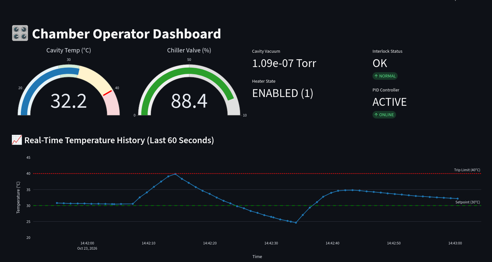
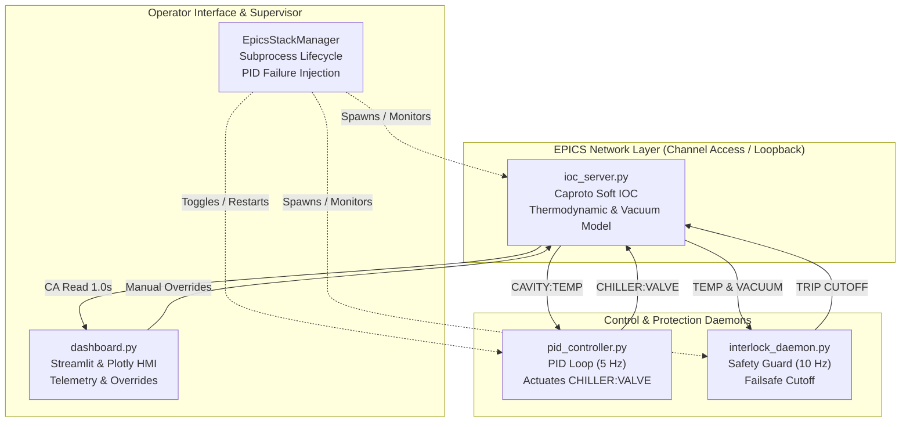

# 🎛️ Vacuum Chamber EPICS Control & Monitoring System

[](https://www.python.org/)
[](https://caproto.github.io/caproto/)
[](https://streamlit.io/)
[](https://plotly.com/)
[](https://opensource.org/licenses/MIT)

A distributed SCADA / Operator Interface (OPI) and hardware simulation stack built for high-vacuum thermal chambers. This system implements the **EPICS (Experimental Physics and Industrial Control System)** Channel Access protocol using **Caproto**, a discrete-time thermodynamic simulation, an autonomous closed-loop PID controller, a high-priority safety interlock daemon, and an interactive real-time dashboard built with **Streamlit** and **Plotly**.



---

## 📑 Table of Contents

- [System Architecture](#-system-architecture)
- [EPICS Process Variable (PV) Catalog](#-epics-process-variable-pv-catalog)
- [Core Components](#-core-components)
  - [1. Soft IOC & Chamber Physics Simulation (`ioc_server.py`)](#1-soft-ioc--chamber-physics-simulation-ioc_serverpy)
  - [2. Closed-Loop PID Temperature Controller (`pid_controller.py`)](#2-closed-loop-pid-temperature-controller-pid_controllerpy)
  - [3. Safety Interlock Daemon (`interlock_daemon.py`)](#3-safety-interlock-daemon-interlock_daemonpy)
  - [4. Operator Dashboard & Supervisor (`dashboard.py`)](#4-operator-dashboard--supervisor-dashboardpy)
- [Failure Mode Simulation & Manual Override](#-failure-mode-simulation--manual-override)
- [Installation & Local Setup](#-installation--local-setup)
- [Running the System](#-running-the-system)
  - [Option A: Integrated Launcher (Recommended)](#option-a-integrated-launcher-recommended)
  - [Option B: Distributed / Multi-Terminal Mode](#option-b-distributed--multi-terminal-mode)
- [Safety Interlocks & Trip Logic](#-safety-interlocks--trip-logic)
- [Deployment Considerations](#-deployment-considerations)
- [License](#-license)

---

## 🏛️ System Architecture

The application is structured into decoupled, event-driven components communicating over standard **EPICS Channel Access (CA)** over TCP/UDP (`ports 5064 / 5065`):



---

## 📋 EPICS Process Variable (PV) Catalog

| PV Name | Type | Access | Scan Rate | Description | Normal Range |
| :--- | :--- | :--- | :--- | :--- | :--- |
| `CAVITY:TEMP` | `FLOAT` | Read-Only | 0.2 s (5 Hz) | Simulated chamber core temperature | 20.0 – 40.0 °C |
| `CAVITY:VACUUM` | `FLOAT` | Read-Only | 0.5 s (2 Hz) | High-vacuum ionization gauge reading | $1.0\times10^{-7}$ Torr |
| `CHILLER:VALVE` | `FLOAT` | Read / Write | Async | Coolant bypass valve opening percentage | 0.0 – 100.0 % |
| `HEATER:ENABLE` | `INT` | Read / Write | Async | Chamber resistive heating element state | `0` (OFF) or `1` (ON) |
| `INTERLOCK:STATUS` | `STRING` | Read / Write | Async | Hardware interlock register status | `"OK"` or `"TRIP: <reason>"` |

---

## ⚙️ Core Components

### 1. Soft IOC & Chamber Physics Simulation (`ioc_server.py`)
Implements an EPICS Input/Output Controller using `caproto.server.PVGroup`. It simulates non-linear chamber thermodynamics and vacuum fluctuations:

- **Thermal Model:**
  $$\Delta T = \left( \dot{Q}_{\text{heater}} - \dot{Q}_{\text{chiller}} - \dot{Q}_{\text{ambient}} \right) \cdot \Delta t + \mathcal{N}(0, \sigma^2)$$
  - **Heating:** $\dot{Q}_{\text{heater}} = 2.5\text{ °C/s}$ when `HEATER:ENABLE = 1` ($0.0\text{ °C/s}$ when OFF).
  - **Chiller Dissipation:** $\dot{Q}_{\text{chiller}} = \left(\frac{\text{Valve}}{100}\right) \cdot (T - 15.0) \cdot 0.16$.
  - **Ambient Heat Loss:** $\dot{Q}_{\text{ambient}} = (T - 22.0) \cdot 0.02$.
  - **Process Noise:** Gaussian noise with standard deviation $\sigma = 0.02\text{ °C}$.
- **Vacuum Gauge Simulation:** Nominal ultra-high vacuum level at $1.0 \times 10^{-7}\text{ Torr}$ with randomized micro-fluctuations.

### 2. Closed-Loop PID Temperature Controller (`pid_controller.py`)
Maintains `CAVITY:TEMP` at a steady **30.0 °C setpoint** by regulating `CHILLER:VALVE`:
- **Gains:** $K_p = 12.0$, $K_i = 0.8$, $K_d = 2.5$
- **Cycle Time:** $200\text{ ms}$ (5 Hz)
- **Actuation Range:** Clamped between $0.0\text{ \%}$ (fully closed) and $100.0\text{ \%}$ (full coolant bypass flow).
- **Telemetry Throttling:** Prints live process variable values every 10 cycles (2 seconds) to avoid console I/O blocking.

### 3. Safety Interlock Daemon (`interlock_daemon.py`)
Hardware protection loop evaluating system telemetry every $100\text{ ms}$ (10 Hz). If trip criteria are met:
1. `HEATER:ENABLE` is immediately forced to `0`.
2. `INTERLOCK:STATUS` is transitioned into an active latched `TRIP: <reason>` state.
3. String status decoding cleans trailing null bytes (`\x00`) to guarantee deterministic string comparison against EPICS `DBF_STRING` records.

### 4. Operator Dashboard & Supervisor (`dashboard.py`)
A Streamlit web interface functioning as an accelerator control room OPI:
- **Supervisor Engine (`EpicsStackManager`):** Manages background IOC, PID, and Interlock daemons on launch using `@st.cache_resource` and registers clean teardown routines with `atexit`.
- **Live Visualizations:**
  - Dynamic Plotly arc gauges for Cavity Temperature and Chiller Valve position with color-coded operational and warning zones.
  - Telemetry metric panels for high-vacuum ionization gauge readings, heater states, and interlock health.
  - 60-second rolling trend plot displaying real-time temperature, setpoint (30 °C), and critical safety threshold (40 °C).
- **Operator Controls:** Manual interlock reset triggers, heater toggle switches, and an automated arbitration system for chiller valve control.

---

## 🛑 Failure Mode Simulation & Manual Override

To simulate real-world hardware, network, and controller anomalies, the Operator Dashboard features an interactive **Fault Injection & Manual Override Subsystem**:

```
       [PID Controller Active] ──(Operator Toggles OFF)──> [Subprocess Terminated]
                 │                                                    │
                 ▼                                                    ▼
   [Manual Slider LOCKED (Read-Only)]                [Manual Slider UNLOCKED (Read/Write)]
   [Autonomous PID Regulates Valve]                 [Operator Modulates Valve Position]
```

### 1. Simulating PID Controller Failure
- **Process Suspension:** Operators can toggle the **PID Controller (Auto Mode)** switch in the sidebar. This instructs `EpicsStackManager` to terminate the running `pid_controller.py` subprocess via `SIGTERM` (with a timeout-escalated `SIGKILL` fallback).
- **Actuator Arbitration:** 
  - **When PID is Active:** The dashboard enforces mutual exclusion by locking the **Chiller Valve (%)** slider (`disabled=True`). This prevents human operator input from racing against the PID loop's 5 Hz writes.
  - **When PID is Offline:** The manual valve slider is immediately unlocked. Operators can manually position the coolant valve from 0% to 100%.

### 2. Thermal Runaway & Protection Demonstration
- When the PID controller is stopped while the heater remains active (`HEATER:ENABLE = 1`), the chiller valve remains stuck at its last known position.
- If the valve is insufficiently open, the chamber enters a **thermal runaway trajectory**.
- Once `CAVITY:TEMP` crosses the **40.0 °C** safety limit, the independent `interlock_daemon.py` acts as a fail-safe: it immediately kills heater power and latches `INTERLOCK:STATUS = "TRIP: Temperature over the limit"`.

### 3. Manual Recovery Sequence
1. With the PID offline, manually increase the **Chiller Valve (%)** slider (e.g., to 75–100%) and click **Set Chiller Valve** to cool down the chamber.
2. Wait until the chamber temperature drops back below **40.0 °C**.
3. Click the **Reset Interlock** button on the sidebar to return status to `HEALTHY`.
4. Toggle the **PID Controller (Auto Mode)** switch back ON. The supervisor will spawn a fresh instance of `pid_controller.py`, automatically taking over closed-loop regulation.

---

## 🛠️ Installation & Local Setup

### Prerequisites
- **Python 3.10+** (tested through Python 3.12)
- Operating System: Linux, macOS, or Windows (WSL recommended)

### Setup Virtual Environment

```bash
# Clone the repository
git clone https://github.com/Yash5320/chamber-epics.git
cd chamber-epics

# Create and activate a virtual environment
python -m venv venv
source venv/bin/activate  # On Windows: venv\Scripts\activate

# Install required dependencies
pip install caproto streamlit plotly pandas numpy scipy
```

---

## 🚀 Running the System

### Option A: Integrated Launcher (Recommended)
`dashboard.py` contains a self-contained supervisor. Launching Streamlit starts the IOC server, the PID loop, and the interlock daemon automatically in the background:

```bash
streamlit run dashboard.py
```
Open your browser at `http://localhost:8501`.

---

### Option B: Distributed / Multi-Terminal Mode
If running across separate machines or debugging individual subsystems, comment out `stack = get_epics_stack()` in `dashboard.py` and run each process in its own shell:

```bash
# Terminal 1: Run the Soft IOC Server
python ioc_server.py

# Terminal 2: Run the Interlock Daemon
python interlock_daemon.py

# Terminal 3: Run the PID Controller
python pid_controller.py

# Terminal 4: Launch the Operator Interface
streamlit run dashboard.py
```

---

## 🚨 Safety Interlocks & Trip Logic

The Interlock Daemon evaluates telemetry at 10 Hz and triggers under the following conditions:

| Parameter | Safety Threshold | Action Taken | Latched? |
| :--- | :--- | :--- | :--- |
| **Over-Temperature** | `CAVITY:TEMP > 40.0 °C` | Immediate Heater Cutoff (`HEATER:ENABLE = 0`) | Yes (`TRIP: Temperature over the limit`) |
| **Loss of Vacuum** | `CAVITY:VACUUM > 1.0e-5 Torr` | Immediate Heater Cutoff (`HEATER:ENABLE = 0`) | Yes (`TRIP: Vacuum degraded`) |

### Clearing an Interlock Trip
1. Allow chamber temperature to drop below **40.0 °C** (chiller will actively cool).
2. Ensure vacuum levels have normalized below **$1.0 \times 10^{-5}\text{ Torr}$**.
3. Click the **Reset Interlock** button on the Operator Dashboard sidebar.
4. Manually re-enable the heater once status returns to `Interlock System: HEALTHY`.

---

## 🌐 Deployment Considerations

### Running on Streamlit Community Cloud
- Caproto binds to loopback interfaces (`127.0.0.1` / broadcast) within the same container. When hosted on Streamlit Cloud, all daemons spawned by `EpicsStackManager` run inside that single Linux container.
- Note that Streamlit Cloud will put inactive apps into sleep mode. When woken up, `@st.cache_resource` will cleanly re-initialize the EPICS stack.

### Running on Real Hardware / Production Subnets
To connect this interface to physical EPICS IOCs or hardware controllers:
1. Remove `EpicsStackManager` from `dashboard.py`.
2. Configure EPICS environment variables on the host:
   ```bash
   export EPICS_CA_ADDR_LIST="192.168.1.255"  # Your facility subnet broadcast
   export EPICS_CA_AUTO_ADDR_LIST="NO"
   ```
3. Update the PV names in the scripts to match your production facility naming conventions (e.g., `VAC:CHAMBER:TC1`, `LLRF:CAV:TEMP`).

---

## 📄 License

This project is open-source under the [MIT License](LICENSE).
